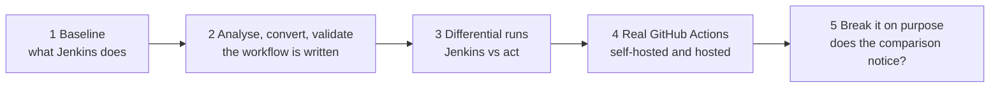

# Walkthrough videos: Jenkins to GitHub Actions

A five-chapter video series (about 23 minutes), plus a 60-second overview, that follows the [example 000 walkthrough](../examples/000/README.md) from
"it works on Jenkins" to "the converted GitHub Actions workflow runs the same steps as the original, and the harness
notices when it does not". It is meant for engineers and for the people who need to understand what the migration does, so the
narration tells the story in plain language while the screen shows the exact commands, output and Jenkins pages.

> [!NOTE]
> The video files are not stored in the repository. They are attached to a
> [GitHub release](../../../releases/tag/walkthrough-videos-v2) so that the repository history stays small. Their
> sources are committed in [`docs/video/`](video/README.md); the two live screen recordings are not, so rebuilding
> chapters 1 and 4 from a fresh clone means recording them again (see that page).

## Watch

Watch on YouTube, in 4K: the [60-second overview](https://www.youtube.com/watch?v=eM67fInxk7k) and the
[five chapters as a playlist](https://www.youtube.com/playlist?list=PLD_4eoDDE3Rk). If the text looks soft, choose 1080p or
higher under the player's gear icon.

| # | Chapter | README parts | Length | YouTube | Download |
|---|---|---|---|---|---|
| 1 | [Baseline on Jenkins](#1-baseline-on-jenkins) | [Part 1](../examples/000/README.md#part-1-run-the-original-jenkinsfile-on-jenkins) | 5:40 | [watch](https://www.youtube.com/watch?v=sF212zKD7iU&list=PLD_4eoDDE3Rk&index=1) | [chapter-1-baseline-on-jenkins.mp4](../../../releases/download/walkthrough-videos-v2/chapter-1-baseline-on-jenkins.mp4) |
| 2 | [Analyse, convert, validate](#2-analyse-convert-validate) | Parts 2 to 4 | 3:48 | [watch](https://www.youtube.com/watch?v=1e5KsFAe9Xc&list=PLD_4eoDDE3Rk&index=2) | [chapter-2-analyse-convert-validate.mp4](../../../releases/download/walkthrough-videos-v2/chapter-2-analyse-convert-validate.mp4) |
| 3 | [Differential runs](#3-differential-runs) | Parts 5 and 6 | 4:57 | [watch](https://www.youtube.com/watch?v=uSTMLFxbliM&list=PLD_4eoDDE3Rk&index=3) | [chapter-3-differential-runs.mp4](../../../releases/download/walkthrough-videos-v2/chapter-3-differential-runs.mp4) |
| 4 | [Real GitHub Actions](#4-real-github-actions) | Part 7 | 5:44 | [watch](https://www.youtube.com/watch?v=PPCxNb9wM7A&list=PLD_4eoDDE3Rk&index=4) | [chapter-4-real-github-actions.mp4](../../../releases/download/walkthrough-videos-v2/chapter-4-real-github-actions.mp4) |
| 5 | [Break the conversion](#5-break-the-conversion) | Part 8 | 3:09 | [watch](https://www.youtube.com/watch?v=rcjCLaNeztM&list=PLD_4eoDDE3Rk&index=5) | [chapter-5-break-the-conversion.mp4](../../../releases/download/walkthrough-videos-v2/chapter-5-break-the-conversion.mp4) |
| | **60-second overview** (live footage, music) | Parts 1 to 8 | 1:00 | [watch](https://www.youtube.com/watch?v=eM67fInxk7k) | [jenkins-to-gha-walkthrough-60s.mp4](../../../releases/download/walkthrough-videos-v2/jenkins-to-gha-walkthrough-60s.mp4) |
| | **Whole series in one file** | Parts 1 to 8 | 23:19 | [playlist](https://www.youtube.com/playlist?list=PLD_4eoDDE3Rk) | [jenkins-to-gha-walkthrough-movie.mp4](../../../releases/download/walkthrough-videos-v2/jenkins-to-gha-walkthrough-movie.mp4) |

The downloads are 1080p H.264 with burned-in captions, about 6 to 13 MB per chapter, and play in any video player. All of
them are listed, with checksums, on the [release page](../../../releases/tag/walkthrough-videos-v2). The YouTube copies are
4K renders of the same videos; the whole series is a playlist there rather than one file.

## What is real, and what is not

- **Terminal output is replayed from real runs**, recorded by the capture scripts in
  [`docs/video/`](video/README.md). Nothing on screen is typed by hand.
- **Jenkins pages are real screenshots** of a disposable local controller. The credentials, the job and the deployment
  approval were sent to it by script (its HTTP API), not clicked. The paused-for-approval screen is a repeat of the default
  build, because the first one had already finished when the screenshots were taken.
- **Two scenes are live screen recordings** of real runs, made separately from the rest: in chapter 1, a Jenkins build
  where the change ticket is typed and Deploy is clicked by hand; in chapter 4, another self-hosted GitHub run. Speed-ups
  are labelled on screen, and the GitHub recording has the account name, run number and commit id masked.
- **GitHub pages are real screenshots** of the recorded runs in the private test repository, taken in a browser with a
  read-only capture tool (`nx shots` with a signed-in profile). The account name and avatar are removed, the page header is
  cropped out, and run ids, run numbers and commit ids are not shown. They sit alongside the terminal output so that you can see the same runs in both
  products.
- **The voice is generated locally** (Kokoro, a British female voice). It is a synthetic voice and a few technical terms
  may sound slightly off.
- **Account and repository names are hidden** in the GitHub chapter, as are run IDs.
- **Numbers belong to the runs that were recorded**: timings, artifact numbers and the usage figures vary from run to run.

> [!IMPORTANT]
> These are demonstrations of one example pipeline, run once per kind of runner, with a local imitation of GitHub Actions
> (`act`) for most runs. They show that the comparison works. They do not prove that a migration is ready for production.
> Chapter 4 includes one GitHub-hosted run, which used 11 billable Actions minutes.

## Chapters

### 1. Baseline on Jenkins

What you will see

Part 1 of the walkthrough, on a throwaway local Jenkins. The service is a small stock-keeping app whose pipeline builds,
tests, packages, publishes and deploys it.

- The two credentials, the job, and the Pipeline Overview with its parallel branches and matrix cells.
- A build paused at the **Deploy** stage, and the approval page asking for a change ticket.
- A separate live recording of the same pipeline: the build pausing at Deploy, the ticket typed in and Deploy clicked.
- Build 1 (defaults): 21 tests, five archived artifacts, fingerprints, and the console lines that matter.
- Terminal checks that the release is sound: checksum, build information, the deploy record with the ticket and approver,
  and the packaged tool running.
- Build 2 (a snapshot): no approval prompt, **Integration tests**, **Publish** and **Deploy** skipped, 20 tests.

**Why it matters:** this is the behaviour the converted workflow has to reproduce.

### 2. Analyse, convert, validate

What you will see

Parts 2 to 4: the three automatic steps, with real output.

- **Analyse:** the Jenkinsfile is parsed with the same Groovy engine Jenkins uses and scored: difficulty 23, "assisted",
  with findings such as the approval gate, Groovy `when` conditions, the hashed cron schedule and the two credentials.
- **Convert:** nine jobs (why the stages are split, and the small gate job that decides whether Deploy runs before anyone
  is asked to approve), with 41 constructs mapped, 33 approximated and 1 needing a person (81.0% automated, which the report
  calls an effort estimate, not a measure of correctness), and a migration report listing every construct.
- **Validate:** actionlint and zizmor find nothing; the project's own policy check raises one warning for a value the
  converter could not translate, which is exactly where a person is needed.

**Why it matters:** the conversion is mostly automatic, and it says plainly what is not.

### 3. Differential runs

What you will see

Parts 5 and 6: the original Jenkinsfile and the converted workflow, run side by side.

- **Trace mode:** every real action is replaced by a marker line on both sides, then the order of steps is compared stage by
  stage. 41 markers each, all ten stages match.
- **Full mode:** the real commands run on both sides and the outcomes are compared; the release built by `act` passes its
  checksum.
- **The gap:** the deploy record shows the approver as `admin` on Jenkins and `unknown` on `act`. A GitHub environment can
  gate a job but cannot pass the approver's name or collect a change ticket.

**Why it matters:** "it went green" is not the test. Matching behaviour is.

### 4. Real GitHub Actions

What you will see

Part 7: the same workflow on GitHub itself, in a private test repository.

- **Self-hosted runners** (short-lived containers on this machine): eleven runners, zero billable minutes, trace and full runs.
- The GitHub run pages for each run: the job graph, a job log with the trace markers, the artifacts list (17, six of them
  the workspace handed between jobs) and the hosted run, plus a live recording of another self-hosted run.
- **GitHub-hosted runners:** the budget check, why the guard's 50-minute cap refused the run (worst case 55) and how it was
  raised for one run, then the run itself: eleven jobs, eleven billable minutes.
- All three runs matched Jenkins.

**Why it matters:** hosted runners are billed per job, rounded up, so a pipeline with many short jobs costs more than its
wall-clock time suggests.

### 5. Break the conversion

What you will see

Part 8: proof that the comparison catches a broken conversion.

- One rule in the generated workflow is flipped so that **Deploy** runs only when it should not. The harness refuses a
  hand-edited workflow unless the run passes `--edited-model`, and such a result is marked and never counted.
- The workflow still succeeds on `act`, but the comparison reports **DIFFERS** (90.2% similarity, 37 steps against 41) and
  the results page names the missing Deploy stage.
- After the workflow is regenerated, the comparison reports **EQUIVALENT** again.

**Why it matters:** a plain "did it go green?" check would have missed this fault.

## Rebuilding or changing the videos

Each chapter is a small project under [`docs/video/`](video/README.md): the script (`scenes.json`), pronunciations, the real
captures with the scripts that produced them, and the screenshots. They are built with the
[`narrated-explainer`](../.claude/skills/narrated-explainer/SKILL.md) agent skill. Changing a sentence or a pronunciation
regenerates only the affected audio clips; a single-process render takes about as long as the chapter plays.

The 60-second overview is a separate project, [`docs/video/000-walkthrough-60s/`](video/000-walkthrough-60s/README.md),
built with the [`hyperframes-walkthrough`](../.claude/skills/hyperframes-walkthrough/SKILL.md) skill.

When a chapter is re-rendered, publish it as a new release (for example `walkthrough-videos-v3`), delete the previous
one, and update the links above, rather than committing video files to the repository. For YouTube, render at 4K
(`nx render --scale 2`, `hfw render --resolution 4k`) and upload by hand; a re-upload gets a new link, so update the
YouTube links above too. Rendering with
`nx render --jobs 3` takes about three quarters of the chapter's length on this machine.
